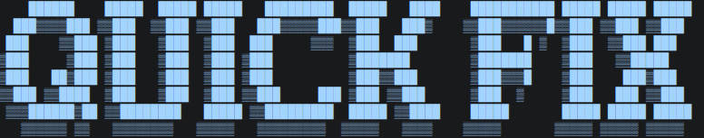

   

---
- **QuickFix is a Windows Platform based program that execute can automatically execute helpful commands and contain list of commands that help for system stability and checking + Fixes Errors in the Mechine**

